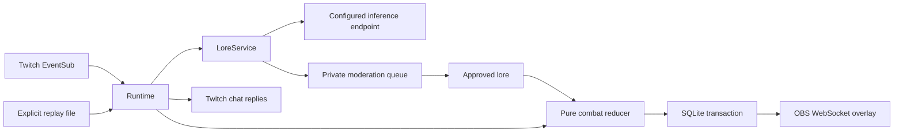

# Architecture

## 1. Runtime and data flow

Lore Boss is one local Node.js process: Fastify serves HTTP/static assets, WebSockets carry overlay updates, and better-sqlite3 persists session and combat records.

The reducer is deterministic for an identical action/time sequence. Runtime scheduling uses an injectable clock for gameplay, while decorative quote cadence uses a wall-clock timer; a source recording alone does not reproduce every wall-clock detail.

## 2. Source map

| Entry | Responsibility |
|---|---|
| `src/index.ts`, `config.ts` | Configuration, loopback binding, startup/shutdown. |
| `src/runtime.ts` | Session ownership, ingestion, cooldowns, gameplay ticks and publication. |
| `src/twitch/` | OAuth validation/refresh, EventSub lifecycle, Helix replies and optional Predictions. |
| `src/events/source.ts`, `src/types.ts` | Event contracts and validated replay scheduling. |
| `src/boss/reducer.ts` | Pure combat transitions, combo/stun/enrage and bounded damage. |
| `src/lore/service.ts`, `src/llm/` | Evidence-constrained extraction, schema validation and safe provider errors. |
| `src/db/store.ts` | SQLite schema/migrations, evidence, reviews, atomic combat writes and history. |
| `src/app.ts`, `src/web/` | Local operator endpoints and browser interface. |
| `src/overlay/`, `src/hall/` | Overlay presentation, state restoration and earned titles. |

Read the actual exported types and schema in source rather than maintaining duplicate type/schema snapshots here.

## 3. Lore and output boundary

Extraction buffers eligible public chat, submits at most 200 messages, and proposes at most five items. Candidates must satisfy schema, cited-message, quote/author and blocked-text checks. A mechanically supported non-quote can still be wrong; the moderator must judge meaning. Edits represent moderator judgment rather than automatic proof of a verbatim quote.

Pending/evidence data is private and session-scoped. Only approved active-session lore powers the ticker, boss and chat replies. Persistent Hall/Lore Book queries separate live and replay sources. A raid recap is explicitly a template, not generated historical prose.

## 4. Consistency and lifecycle

- Delivered scored combat transitions commit event claim, implied viewer/damage/block rows, boss state and finisher within one synchronous SQLite transaction. State assignment/publication follows commit.
- Failed writes roll back and stop ingestion with a safe failure. This is not crash recovery, resumable fights or rollback of post-commit external I/O.
- Durable claims suppress redelivery; per-viewer cooldowns limit commands. Anonymous cheer events do not invent viewer identities.
- Session/configuration generations reject stale asynchronous extraction and provider results.
- The provider client sends at most one outbound request per invocation. Valid bounded numeric Retry-After deadlines gate subsequent requests; there is no silent provider fallback or blind resend.
- OAuth/EventSub own validation, keepalive, reconnect and revocation handling. Prediction creation/settlement is separately capability-gated and HTTP-confirmed; uncertain outcomes require operator inspection.
- Ended-session chat and unapproved lore expire after 24 hours. Approved lore/history remain until purge. Recording files are separate from the database.

## 5. Local threat model and replay

The production server binds to IPv4 loopback and checks Host and any supplied Origin. Private operator APIs require `Authorization: Bearer <MOD_TOKEN>`; OAuth entry/state additionally use scoped cookies. Cookies are host/path scoped, not port isolated. Native local clients may omit Origin; these checks do not defend against untrusted software already running as the same user.

The overlay socket intentionally needs no moderator credential and accepts only acknowledgements from clients. Approved content and community rankings are visible to local overlay clients. Secrets are local ignored files, not encrypted at rest. Never expose the server through a reverse proxy or capture an unreviewed credential editor.

Live is the default. Replay requires explicit configuration, validated per-event ISO timestamps and a visible source label. Scheduling offsets do not replace timestamps. Replay cannot connect to Twitch or send chat. The browser-test playground uses an in-memory replay runtime; its synthetic/test-only routes are not registered in production.

## 6. External APIs

External calls cite official documentation beside their implementations. Consult those sources when modifying requests, scopes or payload normalization:

- [Twitch authentication](https://dev.twitch.tv/docs/authentication/)
- [Twitch EventSub WebSocket handling](https://dev.twitch.tv/docs/eventsub/handling-websocket-events/)
- [Twitch EventSub subscriptions](https://dev.twitch.tv/docs/eventsub/eventsub-subscription-types/)
- [Twitch Helix reference](https://dev.twitch.tv/docs/api/reference/)
- [Groq compatibility](https://console.groq.com/docs/openai) and [structured outputs](https://console.groq.com/docs/structured-outputs)
- [Modal compatible serving example](https://modal.com/docs/examples/vllm_inference)

Do not infer endpoint availability or account capability from saved configuration or mocked tests.