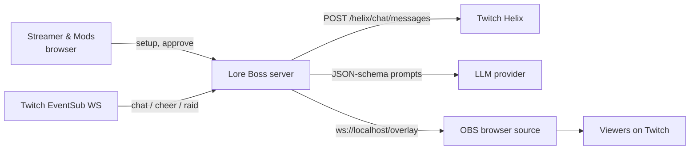
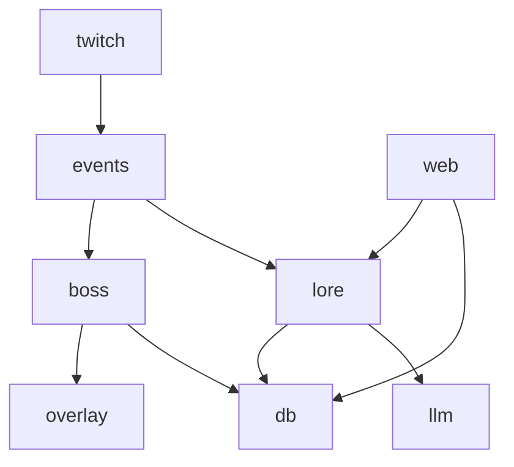

# ARCHITECTURE — Lore Boss
Diagrams: `architecture/*.svg|png` (generated by `architecture/diagrams.py`); also drawn on tldraw canvas `tkrg20lk` (see §11).

| # | Diagram |
|---|---|
| 1 | [System context](architecture/01-system-context.svg) |
| 2 | [Components](architecture/02-components.svg) |
| 3 | [Event flow](architecture/03-event-flow.svg) |
| 4 | [Lore approval sequence](architecture/04-lore-approval.svg) |
| 5 | [Raid recap sequence](architecture/05-raid-recap.svg) |
| 6 | [Data model](architecture/06-data-model.svg) |
| 7 | [Orchestration loop](architecture/07-orchestration-loop.svg) |

## 1. Principles
1. **Deterministic core, AI at the edges.** HP, damage, crits, timers = plain tested code. LLM only writes names, attack flavor, recap prose — always schema-validated, always optional (fallback is a clearly labeled template using *approved* lore text, never invented content).
2. **One event bus, two sources.** `LiveTwitchSource` (default) and `ReplaySource` (only when `LB_SOURCE=replay`) emit identical `LBEvent`s. Replay mode is shown on the overlay as a visible "REPLAY" badge — never hidden.
3. **Nothing public without a mod.** Lore enters as `pending`; only `approved` lore can reach the overlay or chat.
4. **Single local process.** Fastify (HTTP + static) + `ws`, SQLite via `better-sqlite3`. No Extension → no Twitch review on the critical path.

## 2. System context


## 3. Modules (`src/`)
| Module | Responsibility | Key exports |
|---|---|---|
| `twitch/` | OAuth (Authorization Code / Device Code), token validate+refresh, EventSub WS client (welcome→subscribe ≤10s, keepalive, `session_reconnect`, revocation), chat send | `TwitchAuth`, `EventSubClient`, `ChatSender` |
| `events/` | `LBEvent` types, `EventBus`, `LiveTwitchSource`, `ReplaySource` | `EventBus`, `createSource(cfg)` |
| `lore/` | Rolling buffer, periodic extraction, dedupe, queue ops | `LoreService` |
| `boss/` | Pure state machine `idle→spawning→fight→defeated`, damage rules, MVP calc | `reduce(state, event)` |
| `llm/` | Provider client, JSON schemas (zod), 5s timeout, retry ≤1 | `LlmClient` |
| `db/` | Migrations, repositories | `openDb()` |
| `overlay/` | WS server, static overlay page (renders `designs/`) | `OverlayHub` |
| `web/` | Setup page, mod queue (auth: local-only + mod token) | routes |



## 4. Event bus types
```ts
export type Source = 'live' | 'replay';
interface Base { id: string; ts: string; source: Source; channelId: string }
export interface ChatEvent  extends Base { kind: 'chat'; userId: string; userLogin: string; userName: string; text: string; badges: string[] }
export interface CheerEvent extends Base { kind: 'cheer'; userId: string | null; userName: string | null; isAnonymous: boolean; bits: number; message: string }
export interface RaidEvent  extends Base { kind: 'raid'; fromId: string; fromLogin: string; fromName: string; viewers: number }
export interface CommandEvent extends Base { kind: 'command'; userId: string; userName: string; command: '!attack' | '!heal' | '!lore'; args: string[] }
export type LBEvent = ChatEvent | CheerEvent | RaidEvent | CommandEvent;

export type BossPhase = 'idle' | 'spawning' | 'fight' | 'defeated';
export interface BossState { phase: BossPhase; bossId: string | null; name: string | null; hp: number; maxHp: number; attackPool: { loreId: string; text: string; author?: string }[]; damageByUser: Record<string, number>; startedAt: string | null }
```
Field sources (EventSub payloads): chat → `chatter_user_id/login/name`, `message.text`, `badges`; cheer → `user_id` (null if anonymous), `is_anonymous`, `bits`, `message`; raid → `from_broadcaster_user_id/login/name`, `viewers`. Verify exact names in the payload docs before coding (link §6).

## 5. SQLite schema
```sql
CREATE TABLE sessions (id TEXT PRIMARY KEY, source TEXT NOT NULL CHECK(source IN ('live','replay')), channel_id TEXT NOT NULL, started_at TEXT NOT NULL, ended_at TEXT);
CREATE TABLE chat_messages (id TEXT PRIMARY KEY, session_id TEXT NOT NULL REFERENCES sessions(id), user_id TEXT NOT NULL, user_name TEXT NOT NULL, text TEXT NOT NULL, ts TEXT NOT NULL);
CREATE TABLE lore_items (id TEXT PRIMARY KEY, session_id TEXT REFERENCES sessions(id), kind TEXT NOT NULL CHECK(kind IN ('catchphrase','rivalry','moment','quote')), text TEXT NOT NULL, author_user_id TEXT, evidence_message_ids TEXT NOT NULL, -- JSON array, must be non-empty
  status TEXT NOT NULL DEFAULT 'pending' CHECK(status IN ('pending','approved','rejected')), reviewed_by TEXT, reviewed_at TEXT, created_at TEXT NOT NULL);
CREATE TABLE bosses (id TEXT PRIMARY KEY, session_id TEXT NOT NULL REFERENCES sessions(id), name TEXT NOT NULL, max_hp INTEGER NOT NULL, lore_ids TEXT NOT NULL, spawned_at TEXT NOT NULL, defeated_at TEXT);
CREATE TABLE damage_events (id TEXT PRIMARY KEY, boss_id TEXT NOT NULL REFERENCES bosses(id), user_id TEXT NOT NULL, amount INTEGER NOT NULL, crit INTEGER NOT NULL DEFAULT 0, cause TEXT NOT NULL CHECK(cause IN ('attack','cheer','heal')), ts TEXT NOT NULL);
CREATE INDEX idx_lore_status ON lore_items(status);
```
Retention: chat and nonapproved lore purged after session end + 24h (privacy); approved lore persists privately. Runtime output is restricted to the active session. Chat uniqueness is `(session_id,id)`, with a transactional migration from the starter single-column primary key, permitting real-recording replay and durable duplicate suppression.

## 6. Twitch integration — VERIFIED 2026-10-25 against dev.twitch.tv
Sources: https://dev.twitch.tv/docs/eventsub/eventsub-subscription-types/ · https://dev.twitch.tv/docs/eventsub/handling-websocket-events/ · https://dev.twitch.tv/docs/api/reference/ · https://dev.twitch.tv/docs/chat/chatbot-guide/

| Need | Subscription / endpoint | Authorization (as documented) |
|---|---|---|
| Read chat | `channel.chat.message` v1, condition `broadcaster_user_id` + `user_id` (reading user) | "Requires user:read:chat scope from the chatting user. If app access token used, then additionally requires user:bot scope from chatting user, and either channel:bot scope from broadcaster or moderator status." |
| Bits | `channel.cheer` v1, condition `broadcaster_user_id` | "Must have bits:read scope." (broadcaster's authorization) |
| Raids in | `channel.raid` v1, condition `to_broadcaster_user_id` (set from **or** to, not both) | "No authorization required." |
| Send chat | `POST https://api.twitch.tv/helix/chat/messages` | `user:write:chat` (user token); app token path additionally needs `user:bot` + `channel:bot`/mod |
| Optional: chatters | `GET /helix/chat/chatters` | `moderator:read:chatters` |
| Optional: clips | `POST /helix/clips` | `clips:edit` |

WebSocket facts (handling-websocket-events): connect `wss://eventsub.wss.twitch.tv/ws`; "you have 10 seconds from the time you receive the Welcome message to subscribe"; **"WebSockets uses user access tokens. If you use app access tokens with WebSockets, the subscriptions will fail."**; max 3 WS connections with enabled subs per user token; 300 enabled subs per connection; `keepalive_timeout_seconds` 10–600; handle `session_keepalive`, `session_reconnect` (connect to `reconnect_url` before closing old), `revocation`.

### Corrections to the Build Lead plan
1. **user:bot / channel:bot are not needed for the WebSocket path.** They apply only when an *app* access token is used (webhooks/conduits). WebSocket requires a *user* token, so: bot user token with `user:read:chat` (+ `user:write:chat` to reply). Bot as mod is still recommended (rate limits / not being filtered) but not a scope requirement.
2. **Cheer needs the broadcaster's `bits:read`.** Because WS subscriptions use user tokens, the simplest reliable setup is: **run with the broadcaster's own token** (scopes `user:read:chat user:write:chat bits:read`) — the bot can be the broadcaster account for the hackathon. If you want a separate bot account, use a second WS connection authorized by the broadcaster token for `channel.cheer`. *Verify the exact cross-user rule on day 1 with the Twitch CLI before committing to two accounts.*
3. Polls/Predictions/Channel Points are not used (Affiliate/Partner-only per Platform Engineer); bits require an Affiliate channel to occur live → test via Twitch CLI `twitch event trigger channel.cheer` against the CLI mock WS server, labeled as simulated.
4. Board note "CatchUp.help/Pingys do stream summaries" → Pingys is an AI co-host (see RESEARCH.md §6).

Scopes to request (single broadcaster token): `user:read:chat user:write:chat bits:read` (+ optional `moderator:read:chatters`).

## 7. Overlay WebSocket protocol (`ws://localhost:${PORT}/overlay`)
Server→client JSON, versioned:
```ts
type OverlayMsg =
 | { v:1; type:'hello'; source:'live'|'replay'; build:string }
 | { v:1; type:'boss.state'; state: BossState }
 | { v:1; type:'boss.hit'; userName:string; amount:number; crit:boolean; cause:'attack'|'cheer' }
 | { v:1; type:'boss.attack'; loreId:string; text:string; author?:string }
 | { v:1; type:'boss.defeated'; name:string; durationMs:number; mvps:{userName:string;damage:number}[] }
 | { v:1; type:'lore.ticker'; items:{id:string;text:string}[] }
 | { v:1; type:'recap.show'; raider:string; viewers:number; lines:string[]; generatedBy:'llm'|'template'; durationMs:number }
```
Client→server: `{type:'ack'}` only. Overlay **must** render a "REPLAY" badge when `source==='replay'`.

## 8. LLM contracts
Model/provider via env (`LLM_BASE_URL`, `LLM_MODEL`, `LLM_API_KEY`). Final user choice: Groq or Modal; Groq is the workspace configuration. Explicit local, Groq HTTPS and Modal HTTPS endpoints are accepted, with no automatic provider/model substitution. No cloud OpenAI API key required. 5s timeout, at most 1 retry for transient or invalid-response failures; authentication/client errors do not retry. Zod/evidence checks fail closed.
**Lore extraction** input: last ≤200 chat messages `{id,user,text}`. Output schema:
```json
{"type":"object","required":["candidates"],"properties":{"candidates":{"type":"array","maxItems":5,"items":{"type":"object","required":["kind","text","evidence_message_ids"],"properties":{
 "kind":{"enum":["catchphrase","rivalry","moment","quote"]},
 "text":{"type":"string","maxLength":140},
 "author_user_id":{"type":"string"},
 "evidence_message_ids":{"type":"array","minItems":2,"items":{"type":"string"}}}}}}}
```
Server-side checks: every evidence id exists in the buffer; `quote` text must be a substring of one evidence message; blocked-word filter; never include non-public info.
System prompt core: "Extract recurring, good-natured community lore. Only use the provided messages. Cite message ids. Do not invent. No slurs, harassment, personal data. Return JSON only."
**Boss generation** input: approved lore items. Output `{name (≤40), taunt (≤100), attack_lore_ids: string[] (subset of input)}`. Attack text shown = the approved lore text verbatim.
**Recap**: input approved lore; output `{lines: string[3] (≤90 each)}`. Template fallback = top-3 approved lore texts, `generatedBy:'template'`.

## 9. Replay JSONL (`fixtures/replay/*.jsonl`) — ONLY with `LB_SOURCE=replay`
One `LBEvent` per line, `source` forced to `replay` by the loader, `ts` relative offsets allowed via `t_ms`:
```json
{"t_ms":0,"kind":"chat","userId":"u1","userLogin":"viewer_one","userName":"viewer_one","text":"banana is a vegetable","badges":[]}
{"t_ms":1500,"kind":"cheer","userId":"u2","userName":"viewer_two","isAnonymous":false,"bits":100,"message":"Cheer100 die banana"}
{"t_ms":4000,"kind":"raid","fromId":"r1","fromLogin":"raider","fromName":"Raider","viewers":12}
```
Rules: recordings must come from a **real session you ran** (recorder writes these from live events, with consent of participants) or be clearly named `synthetic-*.jsonl` for tests. Demo footage using replay must be labeled on screen.

## 10. Config & ops
`.env` (see `.env.example`); `npm run dev`, `npm test`, `npm run record` (live→JSONL), `npm run replay -- fixtures/replay/x.jsonl`. Health page `/health` shows token scopes (from `GET https://id.twitch.tv/oauth2/validate`), WS status, source mode.

## 11. tldraw
Canvas `tkrg20lk` (tldraw MCP) contains the same 7 diagrams. Its state could not be read back from this environment (checkpoint returned empty), so the **SVG/PNG files here are the canonical exports**; regenerate with `python3 architecture/diagrams.py`.
